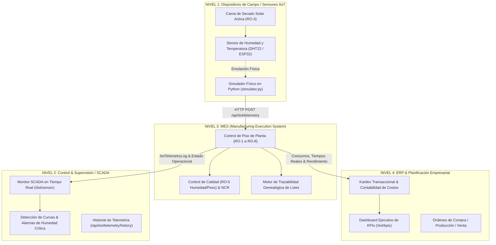

# Evidencia Técnica y Arquitectura ISA-95 - Hito M5: Flujo de Telemetría IIoT
## ReCoffee Solutions - Sistema de Manufactura ERP & MES

Este documento conforma la memoria técnica y evidencia documental de la **Carpeta 5**, explicando detalladamente la arquitectura de integración de telemetría industrial de **ReCoffee Solutions** bajo el estándar internacional **ANSI/ISA-95 (Enterprise-Control System Integration)**.

---

## 1. Introducción y Marco Teórico (Norma ANSI/ISA-95)

La norma **ANSI/ISA-95** define los niveles de interfaz y modelos funcionales para la integración entre los sistemas de control de procesos industriales de planta y los sistemas de gestión empresarial. 

En la planta piloto de **ReCoffee Solutions**, la producción de sustrato orgánico compostable (`PT-001`, bolsa de 5 kg) depende críticamente de la fase de deshidratación y secado solar (**Operación RO-3: Secado Solar Controlado**). La humedad inicial de la biomasa de café y cáscaras orgánicas (~60-70%) debe reducirse metódicamente hasta alcanzar un rango seguro de conservación ($15\% \le H \le 20\%$). Si la biomasa se empaca con humedad superior al 25%, el producto genera hongos y fermentaciones anaeróbicas; si se deseca en exceso (<10%), se degrada la microbiota benéfica del sustrato.

Para asegurar este control de misión crítica, se implementó una arquitectura vertical desacoplada y trazable estructurada en los 4 niveles de la pirámide ISA-95:



---

## 2. Desglose Detallado por Niveles de la Pirámide ISA-95

### Nivel 1: Dispositivos de Campo, Sensores y Adquisición Física
- **Función:** Sensado directo de las variables fisicoquímicas del proceso en la cama de secado solar.
- **Componentes en Planta:** Sensor digital industrial DHT22 acoplado a un microcontrolador IoT (ESP32/NodeMCU) transmitiendo telemetría en el lecho solar de la operación `RO-3`.
- **Implementación Software:** Módulo Python `iiot-simulator/simulator.py` que modela el decaimiento de humedad mediante una ley física exponencial acoplada con fluctuación solar diurna:
  $$H(t) = H_{final} + (H_{inicial} - H_{final}) \cdot e^{-k \cdot t} + \epsilon(t)$$
  donde $H_{inicial} \approx 65\%$, $H_{final} \approx 18\%$, con temperatura ambiente oscilando entre 28°C y 38°C según radiación solar incidente.
- **Payload Generado (JSON):**
  ```json
  {
    "productionOrderId": 2,
    "lotNumber": "LOTE-PT-001-E2E-001",
    "operationCode": "RO-3",
    "sensorId": "SENSOR-DHT-01",
    "temperatureCelsius": 33.4,
    "moisturePercent": 18.2,
    "timestamp": "2026-10-18T14:35:00.000Z"
  }
  ```

> [!NOTE] Marcador de Captura de Pantalla - Nivel 1: Simulador IIoT en Ejecución
> <!-- PLACEHOLDER_CAPTURA_NIVEL_1_SIMULADOR_PYTHON -->
> *Inserte aquí la captura de pantalla de la consola ejecutando `python simulator.py`, evidenciando el envío secuencial de pulsos de telemetría HTTP con código 200 OK hacia la API del backend.*

---

### Nivel 2: Control, Supervisión y Adquisición de Datos (SCADA)
- **Función:** Visualización gráfica en tiempo real de la curva del proceso, detección de anomalías y confirmación del punto óptimo de secado.
- **Componentes:** Interfaz web en Next.js ubicada en la ruta `/iiot/sensor`.
- **Características Técnicas:**
  - **Gráfica de Doble Eje (`recharts`):** Renderiza en el eje izquierdo la trayectoria de evaporación (% de humedad) y en el eje derecho la temperatura de la cama solar (°C).
  - **Línea de Referencia de Umbral Crítico:** Destaca la meta operacional del $20.0\%$ de humedad mediante una línea guía horizontal de color verde esmeralda.
  - **Modo En Vivo (Polling Reactivo):** Capacidad de suscripción periódica automática con refresco en segundo plano.
  - **Pulsos de Prueba Interactivo:** Botón gerencial *"Emitir Pulso IoT"* para simular lecturas desde la UI y validar la respuesta del servidor en tiempo real.
  - **DataGrid Histórico:** Registro tabular ordenado cronológicamente de todas las muestras emitidas para el lote seleccionado.

> [!NOTE] Marcador de Captura de Pantalla - Nivel 2: Monitor SCADA en Tiempo Real
> <!-- PLACEHOLDER_CAPTURA_NIVEL_2_MONITOR_SCADA -->
> *Inserte aquí la captura de pantalla de la interfaz SCADA `/iiot/sensor`, mostrando la curva descendente de secado solar, las tarjetas de estado del sensor DHT-01 y la tabla de telemetría histórica.*

---

### Nivel 3: Gestión de Operaciones de Manufactura (MES)
- **Función:** Orquestación de la producción en piso de planta, registro de tiempos reales de ciclo, validación técnica de calidad y genealogía de lotes.
- **Componentes en Backend (.NET 8):**
  - **Webhook Receptor (`IiotController.cs`):** Endpoint `POST /api/iiot/telemetry` que recibe e ingesta las muestras, validando la existencia de la orden y asignando automáticamente el Lote activo de `RO-3`.
  - **Persistencia Histórica:** Entidad `IiotTelemetryLog` mapeada en base de datos mediante Entity Framework Core.
  - **Seguimiento de Operaciones (`ProductionOrderOperation`):** Control del inicio y fin de operaciones (`RO-1` a `RO-8`), calculando tiempos reales consumidos en mano de obra y máquina.
  - **Control de Calidad (`RO-5` / `QualityInspection`):** Punto de control formal que verifica que la humedad cumpla la tolerancia ($15\% \le H \le 25\%$) y el peso sea de $5.0\text{ kg} \pm 0.1\text{ kg}$. En caso de no cumplir, el sistema bloquea el lote y dispara automáticamente un Reporte de No Conformidad (**NCR**) con disposición de Scrap o Retrabajo.
  - **Motor de Trazabilidad Genealógica (`TraceabilityService.cs`):** Reconstrucción de árbol upstream (hacia atrás hasta los lotes de materias primas y órdenes de compra) y downstream (hacia adelante hasta clientes y órdenes de venta).

> [!NOTE] Marcador de Captura de Pantalla - Nivel 3: Trazabilidad y Calidad MES
> <!-- PLACEHOLDER_CAPTURA_NIVEL_3_MES_CALIDAD -->
> *Inserte aquí la captura de pantalla de la vista de Calidad `/mes/quality` o Trazabilidad `/mes/traceability`, demostrando la relación entre la orden de producción, el lote probado y los parámetros de secado aprobados.*

---

### Nivel 4: Planificación de Recursos Empresariales (ERP) y Business Intelligence
- **Función:** Consolidación financiera, control de inventarios valorizados por FIFO, costeo estándar vs. real, y visualización gerencial de alto nivel.
- **Componentes:**
  - **Kardex Multi-Almacén (`InventoryTransaction`):** Registro inmutable de cada entrada, salida, consumo de WIP y transferencia entre `ALM-001`, `ALM-002`, `ALM-003` y `ALM-004`.
  - **Motor de Cálculo de KPIs (`KpiService.cs`):** Cálculo determinístico de Rendimiento (Yield), Costo Unitario Real por Lote, Rotación de Inventario (Turnover Ratio) y OEE.
  - **Dashboard Ejecutivo (`/iiot/kpis`):** Tablero gerencial con tarjetas estilizadas en Tailwind CSS y navegación por pestañas para auditoría de directores de planta y gerencia general.

> [!NOTE] Marcador de Captura de Pantalla - Nivel 4: Dashboard Ejecutivo ERP
> <!-- PLACEHOLDER_CAPTURA_NIVEL_4_DASHBOARD_EJECUTIVO -->
> *Inserte aquí la captura de pantalla del Dashboard Ejecutivo `/iiot/kpis`, mostrando los 4 indicadores consolidados, la comparación de costos frente al estándar de C$ 90.11 y el desglose de OEE.*

---

## 3. Matriz de Integración Vertical y Flujo de Datos

| Parámetro | Nivel 1 (Sensores) | Nivel 2 (SCADA) | Nivel 3 (MES) | Nivel 4 (ERP) |
| :--- | :--- | :--- | :--- | :--- |
| **Foco Principal** | Captura física | Supervisión operacional | Control de ejecución | Gestión financiera y comercial |
| **Tiempo de Respuesta** | Milisegundos / Segundos | Segundos (1 - 5 s) | Minutos / Horas | Turnos / Días / Meses |
| **Formato de Datos** | Señales analógicas / JSON | Gráficas SVG / WebSockets | Entidades relacionales (EF Core) | Balances, Kardex, Estados de Pérdida/Ganancia |
| **Base de Datos / Storage**| Búfer local de transmisión | Memoria cliente / Cache | PostgreSQL / SQL Server (`IiotTelemetryLog`) | ERP Database (`InventoryTransaction`, `ProductionOrder`) |
| **Protocolo de Comunicación**| HTTP POST / MQTT | REST API / SSE / Polling | ASP.NET Core Web API | REST API / Reportes OLAP |

---

## 4. Conclusiones y Beneficios para ReCoffee Solutions

1. **Eliminación del Error Humano en Secado:** La telemetría automatizada evita que el operador de planta dependa del tanteo manual para retirar el sustrato del lecho solar, garantizando homogeneidad lote a lote.
2. **Trazabilidad de Calidad Inviolable:** Si un cliente reporta exceso de humedad o merma en el producto final, el ERP permite auditar la curva histórica exacta registrada por el sensor durante la operación `RO-3` del lote correspondiente.
3. **Alineación con Estándares Internacionales:** La adhesión rigurosa a la pirámide ISA-95 asegura que la arquitectura de software sea escalable, modular y apta para auditorías de calidad (ISO 9001 / Buenas Prácticas de Manufactura).
